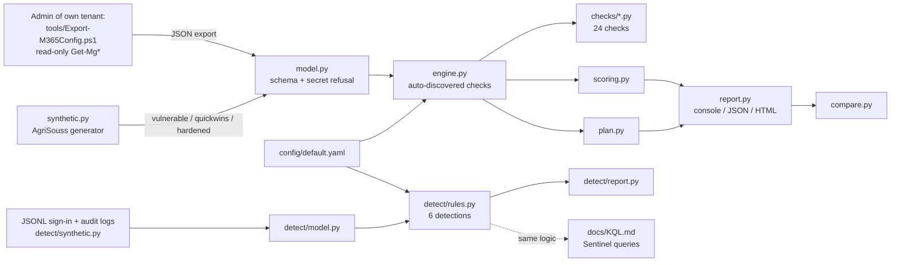

# m365-security-audit: offline Microsoft 365 / Entra ID security audit + log detections

An offline auditor for a **Microsoft 365 / Entra ID configuration export (JSON)**, plus a
small **detection engine for sign-in and audit logs**. Part A runs **24 configuration
checks** (Conditional Access, MFA, legacy authentication, privileged roles / PIM, break-glass
accounts, guests, OAuth consent, mail forwarding, SPF/DKIM/DMARC, Teams, SharePoint, audit
logs), computes a **0-100 risk score (lower is better)** and a prioritised remediation plan
(quick wins / 30 days / 90 days). Part B runs **6 detections** on Entra ID sign-in and
Exchange / Entra ID audit events (password spray, MFA fatigue, legacy authentication,
impossible travel, BEC forwarding rule after an unusual-country sign-in, high-privilege
OAuth consent), each with an equivalent **KQL hunting query** for Microsoft Sentinel.

> **Defensive scope.** No connection to Microsoft Graph, no credential handling, no attack
> tooling. All data shipped here is **synthetic** (fictional SME *AgriSouss SARL*, tenant
> `agrisouss.onmicrosoft.com`, IPs from the RFC 5737 documentation ranges). The tool has
> **never been run against a real tenant**.

## Résumé (FR)

Outil Python qui audite **hors ligne** un export JSON de la configuration d'un tenant
Microsoft 365 / Entra ID et analyse des journaux de connexion et d'audit. 24 contrôles
inspirés du CIS Microsoft 365 Foundations Benchmark, de CISA SCuBA et de Microsoft Learn,
un score de risque 0-100 (plus bas = mieux), un plan de remédiation priorisé, et 6
détections mappées sur MITRE ATT&CK avec leur requête KQL. Score : **80/100** sur l'export
vulnérable, **48** après les quick wins, **0** sur l'export durci ; détections : **6 alertes**
sur les journaux d'attaque, **0** sur les journaux normaux (avec 8 quasi-incidents).
Données synthétiques, projet construit avec l'aide de l'IA, jamais exécuté sur un vrai tenant.

## Quick start

```bash
pip install -r requirements.txt          # PyYAML + pytest, Python 3.11
python -m m365audit list-checks
python -m m365audit audit data/agrisouss_m365_vulnerable.json --html reports/vulnerable.html --json reports/vulnerable.json
python -m m365audit compare data/agrisouss_m365_vulnerable.json data/agrisouss_m365_hardened.json --html reports/compare.html
python -m m365audit detect --signins data/logs/signins_attack.jsonl --audit data/logs/audit_attack.jsonl --html reports/detections_attack.html
python -m m365audit generate --out data   # rebuild the deterministic synthetic data
python -m pytest
```

Exit codes: `0` OK, `1` findings / alerts at or above `--fail-on`, `2` invalid input or config.
Thresholds live in `config/default.yaml` (override with `--config my.yaml`).

## Architecture



| Path | Role |
|---|---|
| `m365audit/model.py` | loads and validates the export (types, enums, duplicates, size, UTF-8/BOM, depth); **refuses any secret-looking key** |
| `m365audit/engine.py` | `Check` base class, `@register` (metadata mandatory: references, severity, effort), plugin discovery, `Finding` |
| `m365audit/checks/` | `access.py`, `privileged.py`, `accounts.py`, `apps.py`, `collab.py`, `audit_logs.py` |
| `m365audit/scoring.py`, `plan.py`, `report.py`, `compare.py` | score, remediation plan, reports, before/after delta |
| `m365audit/detect/` | JSONL loader, 6 rules, alert report, synthetic log generator |
| `tools/Export-M365Config.ps1` | read-only export script (parser-checked, **untested on a real tenant**) |
| `docs/` | `SCHEMA.md`, `SCORING.md`, `EXPORT.md`, `DETECTIONS.md`, `KQL.md` |

## Configuration checks (24)

References: **CIS** = CIS Microsoft 365 Foundations Benchmark (cited by recommendation
title, numbers change between versions), **SCuBA** = CISA Secure Cloud Business Applications
M365 baselines, **MS** = Microsoft Learn. Exact wording per check is in the code and the report.

| ID | Sev. | Check | Main reference | Licence |
|---|---|---|---|---|
| M365-CA-001 | critical | No security defaults and no enabled Conditional Access policy | MS Security defaults; SCuBA MS.AAD.3.2 | all / P1 |
| M365-CA-002 | high | MFA not enforced for all users | CIS "Ensure multifactor authentication is enabled for all users"; SCuBA MS.AAD.3.2 | P1 |
| M365-CA-003 | critical | Privileged roles without MFA policy or registered method | CIS "...for all users in administrative roles"; SCuBA MS.AAD.3.6 | P1 |
| M365-CA-004 | high | Legacy authentication not blocked | CIS "Enable Conditional Access policies to block legacy authentication"; SCuBA MS.AAD.1.1 | P1 |
| M365-CA-005 | medium | No sign-in / user risk policy (only if P2) | SCuBA MS.AAD.2.1 / 2.3 | **P2** |
| M365-CA-006 | medium | Weakened CA policies (broad exclusions, report-only) | MS Plan a CA deployment | P1 |
| M365-PRIV-001 | high | Global Administrators outside 2-4 | CIS "Ensure that between two and four global admins are designated"; SCuBA MS.AAD.7.1 | - |
| M365-PRIV-002 | high | Permanent privileged assignments (no PIM) | CIS "Ensure Privileged Identity Management is used to manage roles"; SCuBA MS.AAD.7.4 | **P2** |
| M365-PRIV-003 | medium | Admin accounts not dedicated (mailbox, licences, synced) | CIS "Ensure Administrative accounts are cloud-only"; SCuBA MS.AAD.7.3 | - |
| M365-PRIV-004 | high | Break-glass accounts missing / not GA / not monitored | MS Manage emergency access accounts; CIS "Ensure two emergency access accounts have been defined" | - |
| M365-ACC-001 | medium | Guest access same as members, everyone can invite | CIS "Ensure that guest user access is restricted"; SCuBA MS.AAD.8.1 / 8.2 | - |
| M365-ACC-002 | medium | Stale enabled members / guests (> 90 days) | MS Manage inactive user accounts | P1 (sign-in activity) |
| M365-ACC-003 | medium | SSPR with one method or security questions | CIS "...number of methods required to reset is set to 2" (older versions); MS SSPR | - |
| M365-ACC-004 | low | Periodic password expiration | CIS "...Set passwords to never expire"; SCuBA MS.AAD.6.1; NIST SP 800-63B | - |
| M365-ACC-005 | medium | Members without MFA method or SMS / voice only | SCuBA MS.AAD.3.5; MS registration campaign | - |
| M365-APP-001 | high | Users may consent to any app | CIS "Ensure User consent for applications is set to Do not allow user consent"; SCuBA MS.AAD.5.2 / 5.3 | - |
| M365-APP-002 | high | Unverified or user-consented apps with high-privilege permissions | MS Detect and remediate illicit consent grants | - |
| M365-APP-003 | medium | All users can register applications | SCuBA MS.AAD.5.1 | - |
| M365-COL-001 | high | External auto-forwarding allowed | CIS "Ensure all forms of mail forwarding are blocked and/or disabled"; SCuBA MS.EXO.1.1 | - |
| M365-COL-002 | high | Custom domain without strict SPF, DKIM or enforced DMARC | CIS DKIM / DMARC / SPF recommendations; SCuBA MS.EXO.2-4 | - |
| M365-COL-003 | medium | Teams open to all domains or consumer accounts | SCuBA MS.TEAMS.2.1 / 2.2 | - |
| M365-COL-004 | medium | SharePoint "Anyone" links without expiry <= 30 days | SCuBA MS.SHAREPOINT.1.1 / 3.1; CIS link sharing | - |
| M365-LOG-001 | high | Unified Audit Log disabled | CIS "Ensure Microsoft 365 audit log search is Enabled"; SCuBA MS.DEFENDER.6.1 | - |
| M365-LOG-002 | medium | Mailbox auditing off or bypassed | CIS "Ensure AuditDisabled organizationally is set to False"; SCuBA MS.EXO.13.1 | - |

## Detections (6)

ATT&CK IDs checked on attack.mitre.org on 2026-10-05 / 2026-10-06 (v19.x).

| ID | Sev. | Detection | ATT&CK | KQL table |
|---|---|---|---|---|
| DET-001 | high | Password spray: >= 10 users failing from one IP in 60 min | T1110.003, T1078.004 | `SigninLogs` |
| DET-002 | high | MFA fatigue: >= 5 MFA denials in 30 min, then success | T1621, T1078.004 | `SigninLogs` |
| DET-003 | high | Successful legacy-protocol sign-in | T1078.004, T1110.003 | `SigninLogs` |
| DET-004 | medium | Impossible travel: > 500 km at > 900 km/h | T1078.004 | `SigninLogs` |
| DET-005 | critical | Unusual-country sign-in, then external forwarding inbox rule within 24 h | T1078.004, T1114.003, T1564.008 | `SigninLogs` + `OfficeActivity` |
| DET-006 | high | Consent to an app with high-privilege permissions | T1528, T1550.001 | `AuditLogs` |

The configuration checks map to T1078.004, T1110.001/.003, T1098.001/.003, T1528,
T1550.001, T1621, T1114.003, T1566 / .003, T1684.002, T1199, T1087.004, T1530, T1213.002 and
T1685.002. Two v19 renumberings: T1685.002 (*Disable or Modify Tools: Disable or Modify
Cloud Log*) is the former T1562.008, and T1684.002 (*Social Engineering: Email Spoofing*,
used for SPF/DKIM/DMARC) is the former T1672. They describe what the weakness makes easier, never how to exploit it.

## Results (synthetic data, 2026-10-06)

| Input | Result |
|---|---|
| `agrisouss_m365_vulnerable.json` (34 users, 2 CA policies) | **80/100 critique**, 24 findings (2 critical, 10 high, 11 medium, 1 low) |
| `agrisouss_m365_quickwins.json` (quick-win actions applied) | **48/100 modéré**, 10 findings, all 30-day / 90-day efforts |
| `agrisouss_m365_hardened.json` (39 users, 5 CA policies) | **0/100 faible**, 0 findings |
| `signins_benign` + `audit_benign` (305 + 5 events, 8 near-misses) | **0 alerts** |
| `signins_attack` + `audit_attack` (330 + 7 events) | **6 alerts**: 1 critical, 4 high, 1 medium (one per rule) |

Tests: **148 passing** (`python -m pytest`): every check fires on the vulnerable export and
is silent on the hardened one, single-mutation tests, threshold boundaries, licence logic,
detection thresholds and near-misses, scores, secret refusal, CLI exit codes, HTML escaping, and a static check that the export
script calls no tenant-modifying cmdlet.

## Limitations (read before trusting a result)

- **Synthetic data only.** The exports and logs were written to exercise the rules; 0 false
  positives on them says nothing about a real tenant.
- **Never run on a real tenant.** The export schema is simplified; `tools/Export-M365Config.ps1`
  and `docs/KQL.md` were syntax-reviewed, not executed. Group-based CA include/exclude is not
  resolved; `sspr`, `isBreakGlass` and `monitoring` are filled by hand.
- **Licences.** Conditional Access and sign-in activity need **Entra ID P1**; PIM and risk-based
  policies need **P2**. `M365-CA-005` is skipped without P2; on a P1-only tenant `M365-PRIV-002`
  still fires and recommends a manual monthly review instead.
- **Snapshot, not monitoring.** A configuration audit is a point in time. Detections are
  teaching heuristics (fixed thresholds, single tenant baseline), not a SIEM.
- Built with the help of AI by a cybersecurity student; references were checked by title,
  but benchmark wording changes between versions.

## Licence

MIT, see `LICENSE`.
